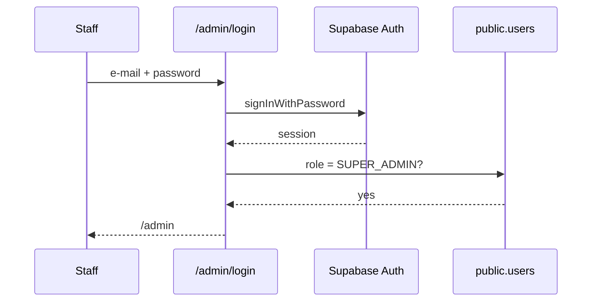

# Supabase setup: MCP, agent skills, project identity and open gaps (29 Oct 2026)

The schema, security model and migration process already live in [`DATABASE_ARCHITECTURE.md`](DATABASE_ARCHITECTURE.md);
variables in [`ENVIRONMENT_VARIABLES.md`](ENVIRONMENT_VARIABLES.md); the admin console in [`ADMIN_CONSOLE.md`](ADMIN_CONSOLE.md).
This page adds only what was missing: how the assistant is connected, which project is which, and what was **not** verified.

## 1. Project identity (the one thing to settle first)

| Where | Project ref | Status |
| --- | --- | --- |
| Documentation (`DATABASE_ARCHITECTURE.md`, `supabase/live/`) and the Supabase dashboard open on 29 Oct | `tgwadczrfbljnepoaqtb` | the shared live project (Free plan, Seoul) |
| `.env.local` on the Mac (`SUPABASE_URL`) | `hiqowfwptvsndrzayifm` (`bsah-academy`) | **INACTIVE (paused)**: a stale local value |
| Vercel environment variables | not readable from the repository | check in Vercel → Settings → Environment Variables |

Action for the owner: set the local `SUPABASE_URL` to `https://tgwadczrfbljnepoaqtb.supabase.co` and `SUPABASE_PUBLISHABLE_KEY` to that
project's publishable key (Supabase → Connect). Keys are never committed (`.env*.local` is git-ignored).

## 2. MCP server

- Added to `.mcp.json` (project scope): `supabase` → `https://mcp.supabase.com/mcp?project_ref=tgwadczrfbljnepoaqtb&features=docs,account,database,debugging,development,functions,branching`.
  The project ref is not a secret; no token is stored in the file.
- **Not authenticated yet.** The Supabase connection that was available in the assistant session belongs to a different Supabase
  organisation (projects `bsah-academy` and `designstudiobyws`, both paused) and cannot see `tgwadczrfbljnepoaqtb`.
  To connect: in a regular terminal run `claude /mcp`, choose `supabase`, then Authenticate with the account that owns the project,
  then start a new session. Verify with the tool that lists projects: it must show `tgwadczrfbljnepoaqtb` before anything is changed.
- Supabase advises a scoped personal access token for agents and CI over a full-account classic token; prefer read-only until a change is approved.

## 3. Agent skills

`npx skills add supabase/agent-skills -y` installed two skills into `.agents/skills/` (symlinked for Claude Code under `.claude/skills/`):
`supabase` (0.1.2) and `supabase-postgres-best-practices`. Rules from them that matter here: RLS on every exposed table; never trust
`user_metadata` in policies; views `WITH (security_invoker = true)`; UPDATE needs a SELECT policy; publishable key in clients, secret key
server-only; verify every fix with a query. The installer's risk table rated both packages Safe (Socket 0 alerts; one Snyk "Med" on `supabase`).
They run with the agent's permissions, so review before updating them.

## 4. Gap report (from the repository only; nothing here was checked against the live database)

| Area | Existing | Missing or at risk |
| --- | --- | --- |
| Operations schema, roles, RLS | live per `DATABASE_ARCHITECTURE.md` §2 | the 001200 anonymous privacy hardening is **prepared, not applied** (§5 there) |
| Website layer (intake, audit, documents, media, buckets) | live (applied 23 Oct) | live state not re-verified since |
| Staff access | `/admin`, `SUPER_ADMIN` role | **no staff account exists yet** (readiness item B2); no second factor (S16) |
| Member accounts (`/account`, `/admin/accounts`) | code and migration `supabase/migrations/20261028000900_member_accounts.sql` | the migration sits in the website-only tree and references `public.profiles`. `DATABASE_ARCHITECTURE.md` says that tree must **never** be applied to the live project (which uses `public.users`). Do not apply it until it is ported to `supabase/live/migrations/` and tested on the replica |
| Schema trees | two trees, decision pending (`DATABASE_RECONCILIATION.md`, B01) | owner choice between platform-canonical and website-first |
| Auth providers | e-mail and password, Google and phone code in code (4 Nov 2026, [`AUTH_METHODS.md`](AUTH_METHODS.md)) | all three are switched on live; **Google is refused by Google (`redirect_uri_mismatch`)**, **phone sign-up of new numbers fails with HTTP 500** until migration 001500 is applied, and SMS delivery is untested; manual steps are in `AUTH_METHODS.md` §3 |
| Backups | none on the Free plan | upgrade decision (G12) |
| Keys | secret and Resend keys were pasted in chat | rotate (see `ENVIRONMENT_VARIABLES.md`) |

Recommended order: (1) authenticate the MCP and confirm the project; (2) create the staff account; (3) switch off unused providers;
(4) decide the schema tree, then port the member-accounts migration to `supabase/live/`; (5) apply 001200 after approval;
(6) rotate keys; (7) backups plan.

## 5. Diagrams (confirmed architecture)

```mermaid
flowchart LR
  Browser -->|forms, sign-in| Next[Next.js on Vercel (icn1)]
  Next -->|publishable key, RLS| Supa[(Supabase tgwadczrfbljnepoaqtb)]
  Next -->|secret key, server only| Storage[private-documents bucket]
  Supa --> RPC[submit_lead_v2, consume_rate_limit, verify_passport]
  Next -->|notify| Resend
```



## 6. What was and was not run (29 Oct)

Run: repository inspection, `.mcp.json` update, skills installation, project-ref comparison. **Not run:** any query, migration, advisor or
policy test against Supabase (no authenticated connection to the project); no application code or migration was changed for Supabase.
